# Ejemplos prácticos con Nuclei

## 1. Entorno de laboratorio

Las pruebas se realizaron en un entorno controlado de VirtualBox, con **Nuclei v3.11.1** instalado en Windows 10 y una máquina **Ubuntu 22.04** como objetivo. Ambas máquinas se comunican a través de una red privada de laboratorio.

| Equipo     | Dirección IP     | Función                                                   |
| ---------- | ---------------- | --------------------------------------------------------- |
| Windows 10 | `192.168.56.101` | Ejecución de Nuclei                                       |
| Ubuntu     | `192.168.56.103` | Servidor de pruebas con Apache, SSH y contenedores Docker |

Para disponer de aplicaciones con fallos conocidos y reproducibles, se utilizaron laboratorios de [ProjectDiscovery Nuclei Templates Labs](https://github.com/projectdiscovery/nuclei-templates-labs). Los servicios vulnerables se desplegaron **en contenedores Docker dentro de la máquina Ubuntu**.

Primero se descargó el repositorio:

```bash
git clone https://github.com/projectdiscovery/nuclei-templates-labs.git
```

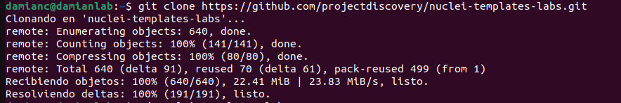


## 2. Reconocimiento inicial del servidor Ubuntu

Antes de trabajar con las aplicaciones vulnerables, se realizó un reconocimiento básico del servidor Apache existente mediante plantillas de identificación de tecnologías:

```powershell
.\nuclei.exe -u http://192.168.56.103 -tags tech -rl 10 -c 5 -ni
```

Nuclei identificó **Apache/2.4.52 (Ubuntu)** y mostró dos coincidencias informativas. Son datos útiles para orientar pruebas posteriores, pero **no acreditan por sí solos la existencia de una vulnerabilidad**.

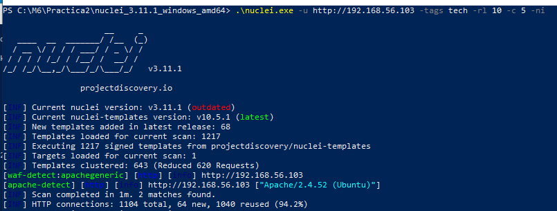

## 3. Laboratorio Next.js: CVE-2025-29927

### 3.1. Preparación

La **CVE-2025-29927** afecta a determinadas versiones de Next.js y permite eludir controles de acceso implementados mediante *middleware* manipulando una cabecera HTTP. El laboratorio del repositorio prepara una aplicación **Next.js 14.0.0** con rutas protegidas, entre ellas `/admin`.

En Ubuntu se accedió al directorio correspondiente y se construyó el contenedor:

```bash
cd ~/nuclei-templates-labs/http/cves/2025/CVE-2025-29927
cat docker-compose.yml
sudo docker compose up -d --build
sudo docker compose ps
```

Docker Compose publica el servicio en el puerto **3000** de Ubuntu. El aviso sobre el atributo `version` obsoleto no impidió el arranque.

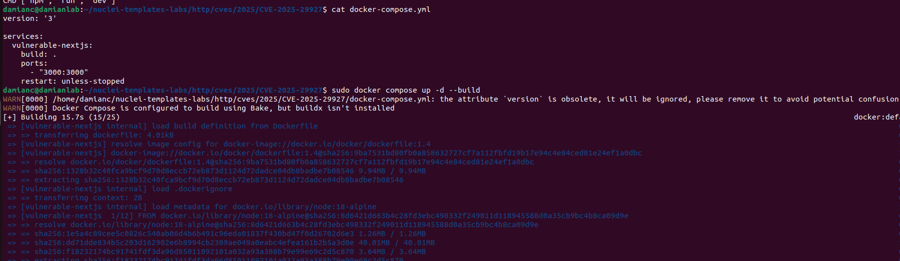

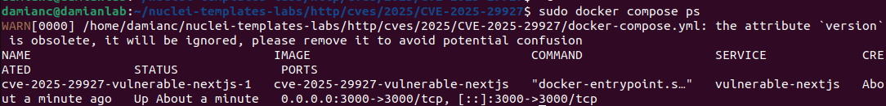

Desde Windows se verificó que la página principal era accesible en `http://192.168.56.103:3000` y que intentar abrir `/admin` sin autorización redirigía a `/unauthorized`.

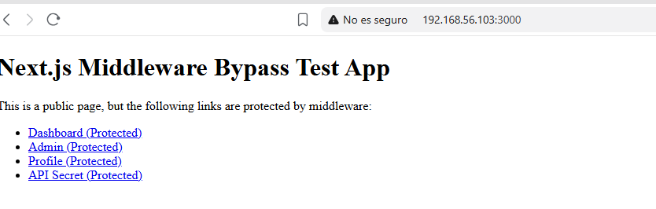

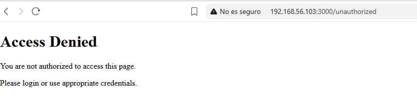

### 3.2. Detección con Nuclei

Se seleccionó exclusivamente la plantilla de la CVE, evitando ejecutar el conjunto completo de plantillas:

```powershell
.\nuclei.exe -u http://192.168.56.103:3000/admin -id CVE-2025-29927 -rl 5 -c 2 -ni
```

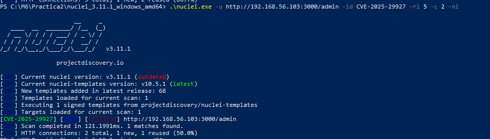

**Resultado:** Nuclei notificó una coincidencia de gravedad **crítica** en `http://192.168.56.103:3000/admin`.


## 4. Laboratorio Kong Gateway: CVE-2020-11710

### 4.1. Preparación

El segundo laboratorio utiliza **Kong Gateway**, un gestor de tráfico y API Gateway. Su archivo Docker Compose publica, entre otros, el puerto **8001/TCP**, correspondiente a la API de administración HTTP.

En Ubuntu:

```bash
cd ~/nuclei-templates-labs/http/cves/2020/CVE-2020-11710
cat docker-compose.yml
sudo docker compose up -d
sudo docker compose ps
```

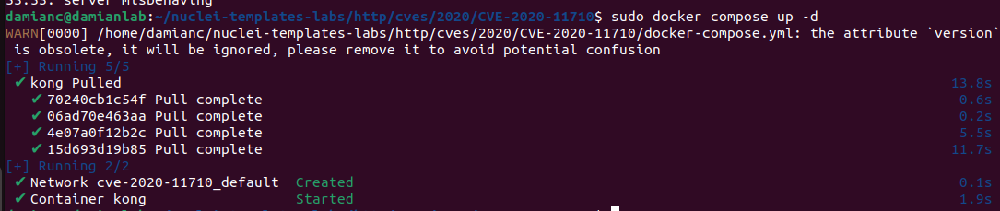

Desde Windows se comprobó que `http://192.168.56.103:8001` devolvía información de configuración de Kong sin solicitar autenticación. 

### 4.2. Detección con Nuclei

```powershell
.\nuclei.exe -u http://192.168.56.103:8001 -id CVE-2020-11710 -ni
```

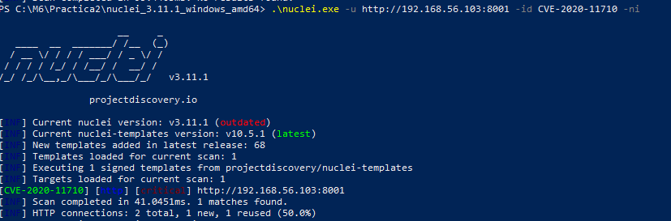

Nuclei devolvió **una coincidencia crítica** con el identificador `CVE-2020-11710`.


## 5. Análisis adicional de configuraciones y servicios

Para conocer otras capacidades de Nuclei se realizaron pruebas complementarias, sin preparar nuevos laboratorios.

### 5.1. Configuraciones HTTP

```powershell
.\nuclei.exe -u http://192.168.56.103:3000 -t http/misconfiguration/ -rl 20 -c 5 -ni -stats
```

Se cargaron **981 plantillas** y se notificaron **10 coincidencias informativas** relacionadas con cabeceras HTTP de seguridad ausentes, como `Content-Security-Policy`, `X-Frame-Options` y `X-Content-Type-Options`.

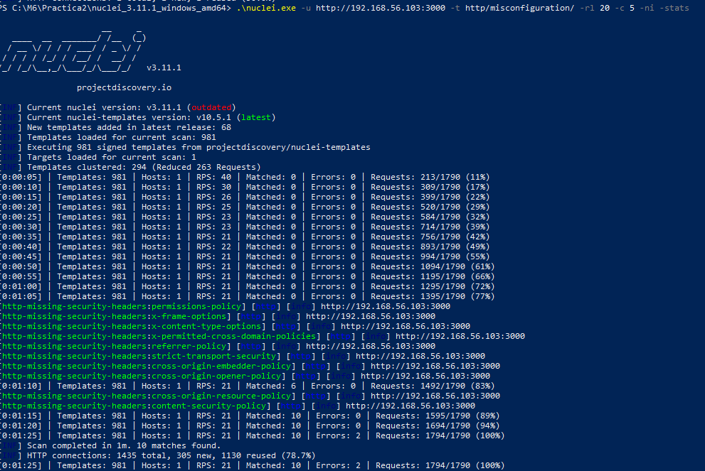

Son recomendaciones de endurecimiento, no diez CVE confirmadas. Su impacto debe valorarse en función de la aplicación y de si utiliza HTTP o HTTPS.

### 5.2. Reconocimiento del servicio SSH

```powershell
.\nuclei.exe -u 192.168.56.103:22 -t network/ -s info,low,medium,high,critical -rl 10 -c 5 -ni -stats
```

Nuclei identificó **OpenSSH 8.9p1 (Ubuntu)**, pero la selección genérica de plantillas de red también produjo errores al aplicarse a un único servicio SSH. Esto muestra por qué resulta preferible seleccionar comprobaciones adaptadas al protocolo.

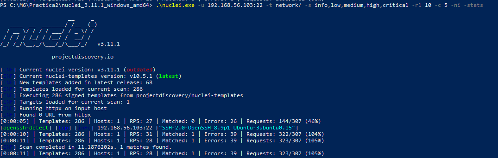

Como prueba más específica, se ejecutaron seis plantillas de `javascript/misconfiguration/ssh/`, sin obtener coincidencias. La ausencia de hallazgos no permite concluir que toda la configuración SSH sea segura.

## 6. Generación de informes

Nuclei permite exportar los hallazgos en Markdown con el parámetro `-me`. Se generaron informes independientes de los dos casos principales:

**Next.js:**

```powershell
.\nuclei.exe -u http://192.168.56.103:3000/admin -id CVE-2025-29927 -ni -me "C:\M6\Practica2\Informes\NextJS"
```

**Kong:**

```powershell
.\nuclei.exe -u http://192.168.56.103:8001 -id CVE-2020-11710 -ni -me "C:\M6\Practica2\Informes\Kong"
```

Los informes generados se han incorporado al directorio `Informes/` del repositorio y pueden consultarse aquí:

- [Informe de CVE-2025-29927 — Next.js](Informes/CVE-2025-29927.md)
- [Informe de CVE-2020-11710 — Kong](Informes/CVE-2020-11710.md)
