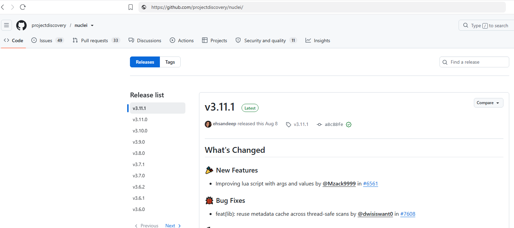
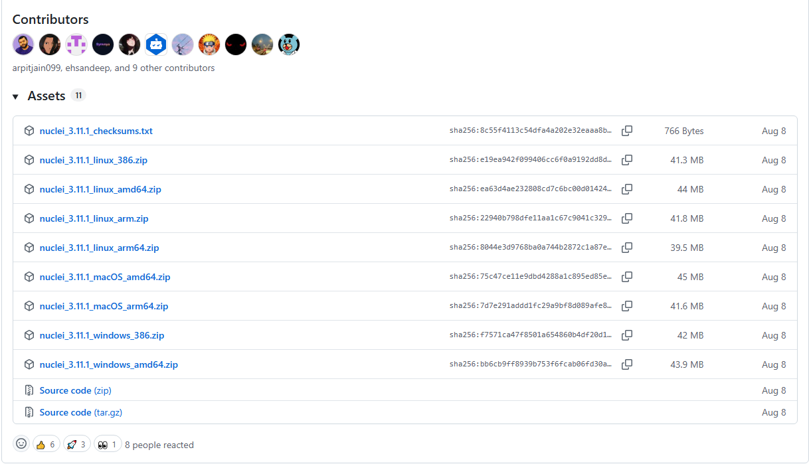
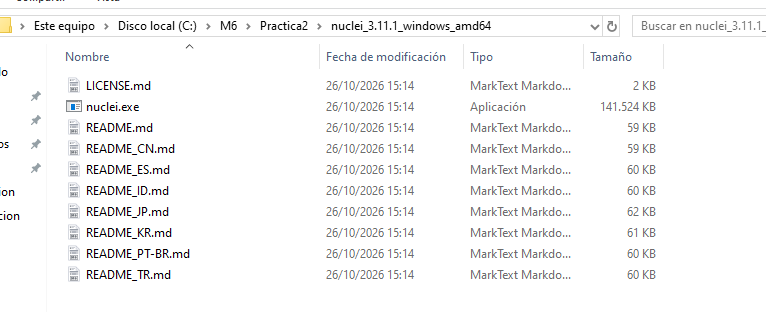
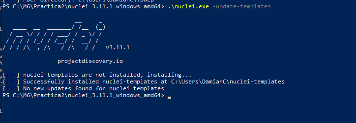
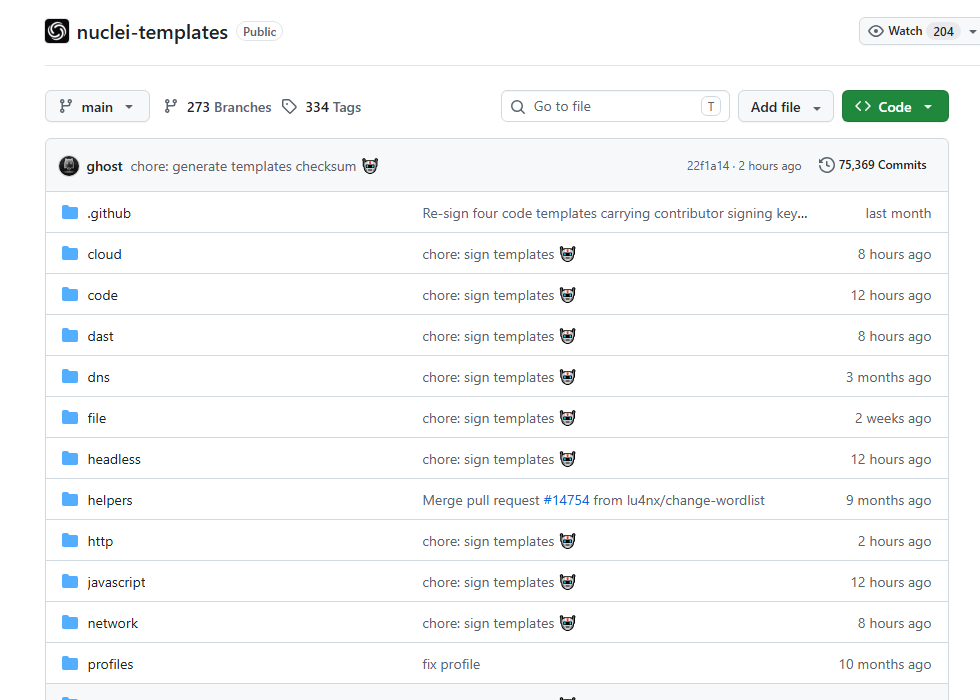
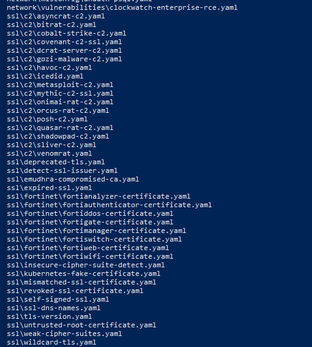

# Instalación de Nuclei en Windows 10

## 1. Introducción

**Nuclei** es un escáner de seguridad de código abierto desarrollado por **ProjectDiscovery**. Utiliza plantillas YAML para realizar comprobaciones sobre servicios y aplicaciones, como la detección de vulnerabilidades conocidas, exposiciones de información y configuraciones inseguras.


## 2. Descarga de Nuclei

Accedemos al [repositorio oficial de Nuclei](https://github.com/projectdiscovery/nuclei/releases), desde el apartado **Releases**, para seleccionar la versión que vamos a utilizar.



En el apartado **Assets** descargamos el paquete `nuclei_3.11.1_windows_amd64.zip`, correspondiente a Windows de 64 bits.



## 3. Preparación y comprobación

Descomprimimos el archivo ZIP en el directorio de trabajo:

```text
C:\M6\Practica2\nuclei_3.11.1_windows_amd64
```

La carpeta contiene `nuclei.exe`, junto con los archivos de licencia y documentación. Al tratarse de un ejecutable independiente, no es necesario utilizar un asistente de instalación.



Abrimos **PowerShell** desde esa carpeta y comprobamos la versión:

```powershell
.\nuclei.exe -version
```

La salida confirma que se está utilizando la versión **v3.11.1** y muestra los directorios de configuración y caché.


## 4. Instalación de las plantillas

Nuclei necesita **plantillas de detección** para ejecutar sus comprobaciones. Las plantillas oficiales se mantienen en el repositorio [projectdiscovery/nuclei-templates](https://github.com/projectdiscovery/nuclei-templates).

### 4.1. Descarga automática (método utilizado)

Desde PowerShell ejecutamos:

```powershell
.\nuclei.exe -update-templates
```

Al no existir una instalación previa de plantillas, Nuclei descargó el conjunto oficial y confirmó su instalación en:

```text
C:\Users\DamianC\nuclei-templates
```



La primera descarga puede tardar varios minutos. Este mismo comando permite comprobar las actualizaciones posteriores.

### 4.2. Descarga manual (método alternativo)

También es posible descargar el contenido del [repositorio oficial de plantillas](https://github.com/projectdiscovery/nuclei-templates) mediante **Code → Download ZIP** y descomprimirlo en una carpeta local.



Si, por ejemplo, las plantillas están en `C:\NucleiTemplates`, podemos indicarle esa ubicación a Nuclei con el parámetro `-t` al ejecutar un análisis:

```powershell
.\nuclei.exe -u http://192.168.56.103 -t "C:\NucleiTemplates" -ni
```

En ese caso, el mantenimiento y la actualización de los archivos descargados deben gestionarse manualmente. **En esta práctica no fue necesario utilizar este método** porque la descarga automática terminó correctamente.

## 5. Verificación de las plantillas

Para comprobar que las plantillas están disponibles ejecutamos:

```powershell
.\nuclei.exe -tl
```

Este comando muestra las rutas de las plantillas reconocidas por Nuclei.



También podemos consultar la versión del conjunto de plantillas y las opciones disponibles:

```powershell
.\nuclei.exe -tv
.\nuclei.exe -h
```

Con la herramienta y las plantillas preparadas, el entorno queda listo para realizar las pruebas descritas en [Funcionamiento](Funcionamiento.md) y [Ejemplos prácticos](Ejemplos%20practicos.md).
